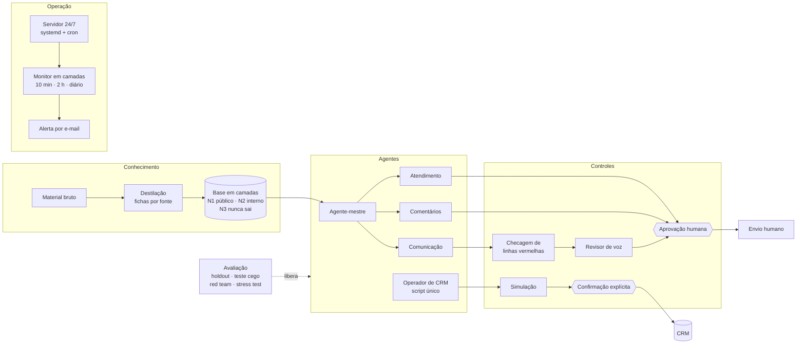

# Agentes de IA com supervisão humana

> **English summary.** A practical playbook for deploying AI agents into a real operation with
> governance. It distills a large private corpus (about 23.8k messages) into a layered knowledge
> base (public / internal / sensitive), derives specialized agents from one master agent, validates
> them with held-out blind tests and red teaming, separates producers from reviewers, keeps a human
> in the loop for every outbound message and every CRM write (dry-run plus explicit confirmation),
> and runs them 24/7 on a Linux server with layered health checks and incident post-mortems.
> All examples use a fictional client; the code runs offline with synthetic data.

Playbook de implantação de agentes de IA numa operação real, com governança. Nasceu de uma
operação de campanha eleitoral (atendimento, comentários em redes, CRM de contatos, produção de
conteúdo) e foi reescrito aqui sobre uma cliente **fictícia**, Helena Corvelo, candidata a
deputada estadual no estado fictício do Meridiano. Nenhum dado de cliente real está neste
repositório.

## O problema

Uma equipe pequena e não técnica precisava responder eleitores no privado, responder comentários
públicos, manter um CRM de milhares de contatos e produzir conteúdo diário, tudo na voz de uma
pessoa específica, com regras legais rígidas (uso de IA em propaganda, proteção de dados) e
**risco alto de erro público**: uma frase fora do lugar vira print.

Os riscos concretos:
- o agente dizer em público algo que a pessoa só disse em privado;
- inventar fato, número ou promessa;
- gravar dado errado (ou de quem pediu para não ser contatado) no CRM;
- parar de responder sem ninguém perceber.

## A solução



| Camada | O que é | Onde |
|---|---|---|
| Conhecimento | Base destilada em arquivos curtos, cada um com nível de confidencialidade | [docs/01](docs/01-base-de-conhecimento.md) · [exemplos/base-helena](exemplos/base-helena/) |
| Agentes | Um agente-mestre e derivações com papel, canal, camada máxima e pessoa gramatical declarados | [docs/02](docs/02-derivacao-de-agentes.md) · [agentes/](agentes/) |
| Avaliação | Holdout separado antes da análise, teste cego com rubrica de 4 eixos, red team, stress test com a dona da voz | [docs/03](docs/03-avaliacao.md) · [avaliacao/](avaliacao/) |
| Produtor ≠ revisor | Três portões independentes: conformidade, voz, mérito | [docs/04](docs/04-produtor-revisor.md) · [skills/](skills/comunicacao-campanha/) |
| Humano no circuito | Rascunho → aprovação → envio humano; CRM com simulação, duplicata, bloqueio e confirmação | [docs/05](docs/05-humano-no-circuito.md) · [ops/bot_rascunho](ops/bot_rascunho/) · [integracoes/clickup](integracoes/clickup/) |
| Operação 24/7 | Deploy em servidor, monitor em três profundidades, alertas fora do modelo, pós-mortems | [docs/06](docs/06-operacao-24x7.md) · [ops/](ops/) |
| Adoção | Tutorial, configuração assistida por função, regras curtas | [docs/07](docs/07-adocao-pela-equipe.md) |
| Lições | 27 lições, cada uma de uma falha ou custo real | [docs/08](docs/08-licoes-aprendidas.md) |

## Técnicas de IA e engenharia

- **Destilação de corpus** com subagentes por fonte (amostra + busca dirigida), em vez de contexto
  bruto; base versionada com changelog.
- **Confidencialidade como dado**: cada arquivo declara a camada; o carregador filtra antes do
  modelo e trata arquivo sem camada como sigiloso.
- **Agente-mestre + blocos de derivação** (10 campos) em vez de prompts independentes.
- **Subagentes com ferramentas mínimas** (só leitura para revisores; um único script para o CRM)
  e **isolamento por pasta**.
- **Defesa em profundidade**: o modelo escala pela persona, e o código também (pré-filtro
  determinístico, checagem de saída, máscara de dado pessoal).
- **Allow/deny explícitos** para que agente em produção nunca dispare pedido de permissão.
- **Avaliação offline** com casos sintéticos, triagem automática e confirmação humana.
- **Operação**: systemd de usuário em modelo, tmux por soquete, cron com cadeado, monitor em
  camadas, alertas por canal independente do modelo, sincronização por conteúdo com simulação.

## Controles de qualidade e governança

| Controle | Garante |
|---|---|
| Camadas N1/N2/N3 aplicadas no carregamento | Material privado ensina o *como*, nunca o *o quê* |
| Holdout + teste cego + red team + stress test | Nenhum agente vai a público sem passar pelos quatro |
| Quem escreve não revisa; revisor não reescreve | Segregação de funções |
| Parecer com endereço da prova | Toda reprovação é verificável na fonte |
| Aprovador autorizado, sem autoaprovação, trilha de auditoria | Rastreabilidade de cada mensagem |
| Simulação por padrão, `--aplicar` explícito, confirmação em texto | Nenhuma gravação acidental |
| Lista de bloqueio intransponível | Pedido de não contato respeitado (LGPD) |
| Declaração de IA em canal público, rótulo de conteúdo sintético | Conformidade com as regras eleitorais de uso de IA |

## Como rodar (tudo offline, com dados sintéticos)

Requer Python 3.10+. Nenhuma dependência para as demonstrações.

```bash
# 1. Fluxo rascunho -> aprovação, com as travas (camada, máscara, escalação,
#    bloqueio, aprovador não autorizado, autoaprovação, auditoria)
python ops/bot_rascunho/demo.py

# 2. Operador de CRM: simulação, duplicata e lista de bloqueio
python integracoes/clickup/operar_contato.py inserir --nome "Ana Nova" \
    --telefone "(00) 90000-0333" --offline exemplos/crm_ficticio.json
python integracoes/clickup/operar_contato.py inserir --nome "Rita Bloqueada" \
    --forcar --aplicar --offline exemplos/crm_ficticio.json   # recusa mesmo com --forcar

# 3. Avaliação: red team (com 3 falhas plantadas) e teste cego
cd avaliacao
python avaliar.py red-team --casos casos/red_team.jsonl \
    --respostas exemplos/respostas_red_team.jsonl --sigilo exemplos/marcadores_sigilo.txt
python avaliar.py holdout --notas exemplos/notas_holdout.csv
```

Para rodar de verdade: bot de rascunho com `pip install -r ops/bot_rascunho/requirements.txt` e
as variáveis de [`ops/.env.example`](ops/.env.example); servidor conforme [`ops/README.md`](ops/README.md);
ClickUp conforme [`integracoes/clickup/README.md`](integracoes/clickup/README.md).

## Resultados na operação de origem

Números medidos no caso real; a cliente fictícia deste repositório não tem resultados próprios.

| Indicador | Valor |
|---|---|
| Corpus destilado na base | ~23,8 mil mensagens de 12 exportações de conversa |
| Agentes especializados derivados da mesma base | 4 |
| Bots em operação contínua no servidor | 3 |
| Red team (20 perguntas hostis) | 13 OK, 7 escaladas corretamente, **0 vazamentos de camada, 0 violações**; 10 ambiguidades de regra corrigidas |
| Teste cego (15 casos de um holdout de 50 mensagens) | média 1,45 de 2 (vocabulário 1,60 · ritmo 1,27 · tom 1,47 · posição 1,47); 5 ajustes priorizados |
| Base de forma da voz em comentários | medida em 4.026 comentários reais |
| Memória por agente no servidor | ~440 MB (a estimativa sem medição errava por três vezes) |
| Custo de modelo | ~US$ 118 equivalentes em 30 dias a 3 h/dia; 83% de um único agente no modelo maior |
| Reboot de teste | serviços de volta em ~15 s, sem intervenção |
| Alertas por chat que não viraram ação, antes da troca para e-mail | 23 em dez dias |
| Falsos positivos eliminados no monitor | 24 religamentos indevidos e 19 alarmes falsos |

## Limitações

- O detector de "mensagem parada" lê a tela do terminal do agente; é útil, mas frágil a mudanças
  de interface (ver PM-3 no doc 06). O bot Python deste repositório não depende dele.
- A triagem automática do red team usa termos e expressões regulares: serve para priorizar, não
  para julgar. A confirmação é humana.
- O teste cego mede semelhança com a pessoa, não qualidade de resultado (conversão, satisfação).
- A demonstração usa respostas gravadas; resultados com um modelo real variam e precisam ser
  medidos no seu caso.
- Regras eleitorais citadas são as brasileiras; outro contexto regulatório exige rever o `05`.

## O que isso mostra para uma empresa

O padrão é o mesmo em qualquer operação onde um agente fala em nome de alguém ou grava dado:

| Área | Base em camadas | Humano no circuito | Avaliação | Operação |
|---|---|---|---|---|
| **SAC** | Política comercial em N1; margens e casos internos em N2; dados de clientes nunca no agente | Agente rascunha; atendente envia; alçada para desconto | Holdout de tickets bem resolvidos; red team com pedido fora da política e "você é humano?" | Monitor que testa resposta real, não só "serviço de pé" |
| **Backoffice** | Normas internas com dono e data | Simulação e confirmação antes de lançar no ERP | Casos sintéticos de exceção | Reprocessamento seguro, log que não mente |
| **CRM e vendas** | Playbook por segmento | Duplicata exata, lista de não contato intransponível, um registro por vez | Auditoria de cada gravação | Sincronização por script, cópia nunca editada à mão |
| **Compliance** | Linhas vermelhas como arquivo obrigatório | Parecer com citação da norma; parecer não é aprovação | Red team regulatório | Trilha de auditoria append-only |
| **Marketing** | Voz da marca com exemplos reais | Produtor ≠ revisor de claims ≠ revisor de voz | Teste cego com textos aprovados | Lote semanal com gate de duplicata |

## Estrutura

```
agentes-ia-com-supervisao-humana/
├── README.md
├── docs/                 01 base · 02 derivação · 03 avaliação · 04 produtor/revisor
│                         05 humano no circuito · 06 operação 24/7 · 07 adoção · 08 lições
├── agentes/              atendimento · comentarios · revisor-voz · checagem-linhas-vermelhas · operador-crm
├── skills/comunicacao-campanha/   SKILL.md · reguas/ · vozes/ (_template, helena-corvelo)
├── ops/                  bot_rascunho/ · monitor/ · systemd/ · cron/ · deploy/ · permissoes/ · .env.example
├── integracoes/clickup/  clickup_client.py · operar_contato.py · config.exemplo.json
├── avaliacao/            rubrica.md · avaliar.py · casos/ · exemplos/
└── exemplos/             base-helena/ · crm_ficticio.json
```

## Licença

MIT. Código e documentação. Ver [LICENSE](LICENSE).
