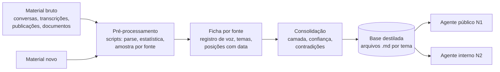

# 01 · Base de conhecimento destilada e níveis de confidencialidade

## O problema

A tentação, com um modelo de contexto longo, é jogar todo o material bruto (anos de conversas,
transcrições, documentos) em cada agente. Isso falha de três jeitos: custa caro a cada chamada,
mistura o que é público com o que é íntimo, e não deixa ninguém corrigir uma informação em um
lugar só.

## A solução: destilar uma vez, servir a todos

O material bruto é processado **uma vez** e vira uma base de arquivos curtos e estruturados.
Os agentes leem só a base, nunca o bruto.

No caso real que originou este método, cerca de **23,8 mil mensagens** (12 exportações de
conversa) viraram uma base de poucos arquivos temáticos. Os agentes derivados nunca leram uma
mensagem bruta.

### Pipeline

| Fase | O que faz | Custo controlado por |
|---|---|---|
| 0 · Pré-processamento | Scripts separam as mensagens da pessoa, contam marcas (emojis, risos, abreviações) e geram uma amostra por fonte | Código, sem modelo |
| 1 · Ficha por fonte | Um subagente por fonte lê a amostra + busca dirigida por tema e produz a ficha: registro de voz, temas, posições com citação e data | Amostra, não a fonte inteira |
| 2 · Consolidação | Cruza as fichas: cada posição recebe fonte, data, camada, confiança (alta se recorrente em fontes distintas) e checagem de contradição | Uma passada |
| 3 · Ingestão incremental | Material novo entra pelo mesmo funil (vídeo e áudio são transcritos antes) e é registrado no changelog | Só o delta |
| 4 · Validação | Teste cego, revisão da própria pessoa, red team (ver doc 03) | Obrigatória antes de derivar |
| 5 · Derivação | Agentes herdam a base (ver doc 02) | |

### Estrutura da base

| Arquivo | Conteúdo | Camada |
|---|---|---|
| `00-identidade` | Trajetória e fatos públicos | N1 |
| `01-voz-e-estilo` | Como a pessoa escreve, **por registro** (íntimo, equipe, militância, público) | N2 |
| `02-posicoes` | Um item por tema: posição, formulação dela, fonte, data, camada, firmeza | N1/N2 por item |
| `03-vocabulario` | Assinaturas, expressões, o que nunca usa | N2 |
| `04-pessoas` | Quem é quem nos círculos dela | **N3: nunca sai da base** |
| `05-linhas-vermelhas` | O que nenhum agente diz, o que sempre escala, regras legais | N1, obrigatório em todos |
| `06-framework` | Leituras e referências, **separadas** do que ela diz | N2 |
| `99-pendencias` | O que está em disputa ou aguardando decisão | N2 |
| `CHANGELOG` | O que mudou, por quê, quem decidiu | |

Um exemplo funcional, fictício, está em [`exemplos/base-helena/`](../exemplos/base-helena/).

## Os três níveis de confidencialidade

| Nível | O que é | Quem pode verbalizar |
|---|---|---|
| **N1 · público** | Veio de fonte pública ou foi validado explicitamente pela pessoa | Agentes de canal público e internos |
| **N2 · interno** | Estratégia, bastidor não sensível, estilo íntimo | Só agentes internos |
| **N3 · sensível** | Conversas íntimas, opiniões privadas sobre pessoas, temas explosivos | **Ninguém, nem agente interno.** N3 informa o estilo, nunca o conteúdo |

**A regra que não se negocia:** material privado ensina **como** a pessoa fala; **o que** um agente
público afirma vem só de fonte pública ou validada. Um agente que reproduz em público uma opinião
dita em grupo fechado é crise pronta, e rastreável até a organização.

### Como a camada é aplicada no código

Cada arquivo da base declara `Camada: Nx` no cabeçalho. O carregador
([`ops/bot_rascunho/nucleo.py`](../ops/bot_rascunho/nucleo.py), `carregar_base`) só entrega ao
agente os arquivos até a camada máxima do papel dele, **trata arquivo sem camada como N3** (na
dúvida de sigilo, não entra) e recusa N3 mesmo que alguém peça. A camada é uma propriedade do
dado, não uma instrução que o modelo pode esquecer.

## Regras de manutenção

1. **Toda posição é datada.** Em contradição, vale a mais recente; mudanças relevantes viram nota
   de evolução (útil para responder a acusação de incoerência).
2. **Leitura não vira fala.** Livros e cursos entram como framework, não como posição. O agente
   nunca pode ser mais radical nem mais erudito que a pessoa real.
3. **Registro público pode estar sub-representado.** Se o material é quase todo privado, o
   registro público fica marcado "pendente de fonte" até entrarem publicações e entrevistas; não
   se extrapola o público a partir do íntimo.
4. **Changelog obrigatório.** Em operação, posição muda; é preciso saber que versão cada agente
   usava em cada data.
5. **Cópias se sincronizam por script, nunca à mão.** Agente isolado lê cópias da base; quem tem
   duas cópias tem uma desatualizada por padrão (ver doc 06).

## Como se transfere

Troque "candidata" por "empresa" e a estrutura se mantém: `00` é o institucional, `02` é a
política de produtos e preços com dono e data, `05` é o que o atendimento nunca promete (prazo,
desconto, diagnóstico), `04` são os dados de clientes e funcionários que nunca chegam a um agente.
