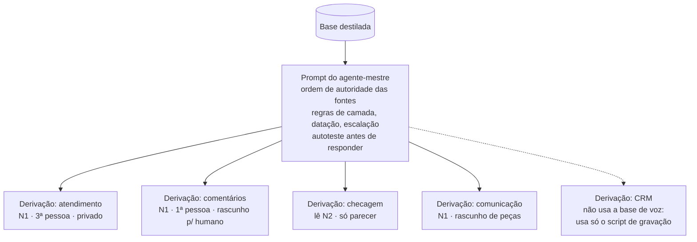

# 02 · Derivação de agentes a partir de um agente-mestre

## Ideia

O **agente-mestre** é um prompt orquestrador + a base destilada. Ele não atende ninguém: é o
espelho fiel da voz, das posições e da história da pessoa. Cada agente de produção é uma
**derivação**: o mestre + um bloco curto que declara papel, canal e limites.

Corrigiu uma posição na base, todos os derivados herdam a correção. Criou um canal novo, escreve
um bloco de derivação, não um agente do zero.

No caso real, a mesma base alimentou **4 agentes especializados** (atendimento, comentários,
comunicação e checagem de linhas vermelhas) e **3 bots** em produção contínua.

## O prompt do mestre (estrutura)

1. **Ordem de autoridade das fontes**: linhas vermelhas primeiro, depois posições, identidade,
   voz, framework, pendências.
2. **Regras de operação**: camada máxima do papel; registro de voz pedido; nunca inventar
   (sem fonte = lacuna declarada); datação (em conflito vale o mais recente); escalação dos temas
   do `05` mesmo sabendo a resposta; regras legais de IA; tom; **microfatos pessoais** (agenda,
   saúde, onde está) nunca se inventam, viram `[FATO PESSOAL: confirmar]`; objetividade
   (responder só o essencial).
3. **Formato de saída**: o conteúdo, a linha de fontes usadas, a camada do que foi produzido e
   alertas de linha vermelha.
4. **Autoteste** antes de cada resposta: viola linha vermelha? cada posição tem fonte? a voz bate
   com o registro e o canal? alguém poderia confundir a saída com fala direta da pessoa num canal
   onde isso é proibido?

## O bloco de derivação (10 campos)

| # | Campo | Exemplo (atendimento) |
|---|---|---|
| 1 | Papel | Rascunhar resposta a eleitor para a equipe revisar |
| 2 | Canal | Ferramenta interna (chat da equipe) |
| 3 | Público | Equipe de atendimento |
| 4 | Camada máxima | N1 |
| 5 | Registro de voz | Público, português correto, caloroso |
| 6 | Pessoa gramatical e declaração de IA | 3ª pessoa; não fala com o eleitor, então não se declara |
| 7 | Escopo | Faz: rascunho. Não faz: publicar, cadastrar, responder comentário |
| 8 | Escalação | Lista do `05` + contato humano do canal |
| 9 | Formato | Texto copiável primeiro; marcações para a equipe abaixo |
| 10 | Versão da base | 1.0 (atualizar anexos quando o changelog mudar) |

### A regra da pessoa gramatical

| Tipo de agente | Pode falar como a pessoa? | Declara ser IA? |
|---|---|---|
| Fala direto com o público | **Não.** Fala *sobre* ela | Sim, na primeira mensagem e sempre que perguntado, sem esperar escalação |
| Rascunha para um humano revisar e enviar | Sim, porque o processo termina humano | Não precisa (não fala com o público) |
| Interno da equipe | Sim, em minuta marcada como rascunho | Não |

## Isolamento por pasta

Agentes com ferramentas de arquivo (Read, Grep, Bash) enxergam o que estiver no disco, não só o
que foi "anexado". Por isso cada agente de produção roda **numa pasta enxuta** que contém apenas:
a persona (`CLAUDE.md`), as permissões (`.claude/settings.json`) e as cópias das fontes da camada
dele. A raiz do projeto (com orçamento, pesquisa e dado pessoal) fica fora do alcance.

Consequência a documentar no próprio agente: as cópias citam caminhos que não existem dentro da
pasta isolada. "Ponteiro quebrado não é sinal de que falta fonte, é o preço do isolamento": o
agente não sai procurando.

## Definições de exemplo

Em [`agentes/`](../agentes/), no formato de subagentes (`.claude/agents/*.md`, frontmatter com
nome, descrição de quando usar e quando NÃO usar, e ferramentas mínimas):

| Agente | Ferramentas | Escreve onde? |
|---|---|---|
| `atendimento` | Read, Grep, Glob | Só texto na conversa |
| `comentarios` | Read, Grep, Glob | Só texto na conversa |
| `revisor-voz` | Read, Grep, Glob | Só parecer |
| `checagem-linhas-vermelhas` | Read, Grep, Glob | Só parecer |
| `operador-crm` | Bash (um único script) | CRM, com simulação e confirmação |

A descrição de cada agente diz **quando não usar** e aponta o agente certo. Isso evita o erro mais
comum de operação: mandar a pergunta ao agente errado e receber a resposta na voz errada.
