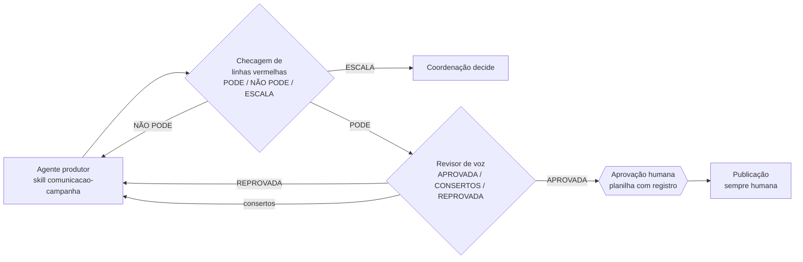

# 04 · Separação entre quem produz e quem revisa

## O princípio

**Quem escreve não revisa a própria peça.** Um modelo que acabou de gerar um texto tende a
confirmar o próprio texto; um revisor com outra instrução, outra rubrica e sem o histórico da
geração encontra o que o autor não vê. É o mesmo princípio de segregação de funções de qualquer
controle interno: quem lança não aprova.

## Três portões, três perguntas, três agentes

| Portão | Pergunta | Saída | Nunca faz |
|---|---|---|---|
| Checagem de linhas vermelhas | **Pode ir?** | Parecer com veredito e **endereço da prova** (arquivo e item) para cada ponto | Reescrever a peça |
| Revisor de voz | **Soa como a pessoa?** | Rubrica de 7 perguntas, PASSA/FALHA com uma frase cada, consertos mínimos | Julgar mérito ou conformidade |
| Análise de comunicação | **É boa para o objetivo?** | Nota por critério (gancho, retenção, adequação público/etapa, força da ideia, aderência editorial, executabilidade) e 2-3 ajustes de maior alavancagem | Reescrever a peça inteira |

Separar os portões resolve o defeito do revisor único, que mistura "não pode" com "não gostei":
o autor passa a saber o que é obrigatório e o que é sugestão.

## Desenho de cada revisor (o que faz um revisor confiável)

1. **Lê as fontes antes de julgar, sempre, na ordem declarada.** O revisor de checagem lê o
   arquivo de linhas vermelhas inteiro em toda sessão; não confia em memória.
2. **Procura antes de dizer "não está escrito".** "Procurei e não está na base" é veredito
   valioso: significa não-assunto ou invenção.
3. **Cita a prova, não a recita.** O parecer diz veredito, motivo e endereço. Quem tem acesso
   confere na fonte. Isso é **contenção na saída**: o revisor de checagem lê mais camadas que os
   agentes públicos, e por isso é o de maior risco de vazamento. Se o motivo real é sigiloso, o
   veredito é ESCALA com motivo genérico.
4. **Não é carimbo.** PODE é parecer, não aprovação. Se alguém disser "o agente aprovou", a
   correção é "o agente deu parecer".
5. **Em dúvida de sigilo, nunca libera.** Escala.
6. **Não inventa linha vermelha.** Peça dura mas dentro da base recebe PODE. Zelo excessivo
   esvazia o conteúdo e treina a equipe a ignorar o revisor.
7. **Todo achado tem uma frase de julgamento.** Sem a frase, não é achado.
8. **Respeita o grau da regra.** Cada regra da ficha de voz tem grau (REGRA, ORIENTAÇÃO,
   PREFERÊNCIA, EXEMPLO). Reprovar por orientação é erro do revisor: vira ajuste sugerido.
9. **Autoconferência antes de fechar**: li a fonte nesta sessão? procurei? cada ponto tem prova?
   transcrevi o que devia só endereçar? reescrevi sem querer?

## Duas regras de calibração que vieram da operação

- **"Contagem serve para fato, não para voz."** Listas de palavras proibidas e expressões
  regulares funcionam para número de urna, grafia, identificação legal. Para tom, a pergunta é
  "é assim que a pessoa diria, para esse público, agora?". Um revisor que só conta aprova texto
  de jornal que não tem nenhuma palavra proibida.
- **"Ordem é regra; comentário é direção."** Quando a pessoa comenta uma peça ("não gostei dessa
  frase"), isso não vira proibição permanente da palavra. Revisores que transformam comentários
  pontuais em regras gerais acumulam vetos contraditórios e empurram toda produção para o
  genérico. Regras se **destilam** numa versão única vigente, não se empilham.

## Reescrita de material da própria pessoa

Quando a matéria-prima é uma fala gravada, o produtor só pode **cortar, reordenar e encurtar**, e
entrega uma tabela de diff: o que foi dito (literal, com a origem), o que ficou, e a classificação
de cada mudança. O revisor refaz a classificação por conta própria, sem confiar na do autor.
Troca de palavra por sinônimo, sintaxe alisada ou argumento trocado reprova.

## Registro

Cada portão deixa uma linha na planilha de aprovação: `portão | data | veredito | n consertos`.
Peça sem o registro dos portões não entra na fila de aprovação humana.

## Para empresas

| Contexto | Produtor | Portões |
|---|---|---|
| Marketing | Agente redator | Compliance de claims (regulatório) · voz da marca · performance |
| Jurídico | Agente que minuta contrato | Checagem contra playbook de cláusulas · revisor de linguagem · advogado |
| Crédito / backoffice | Agente que prepara parecer | Checagem de política (com citação da norma interna) · aprovador humano por alçada |
