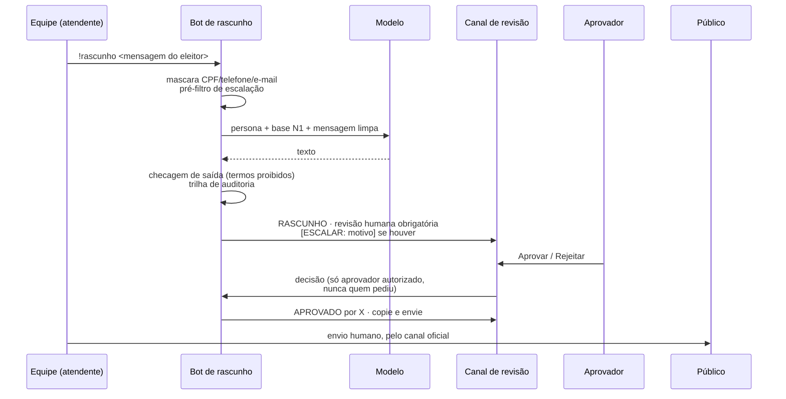
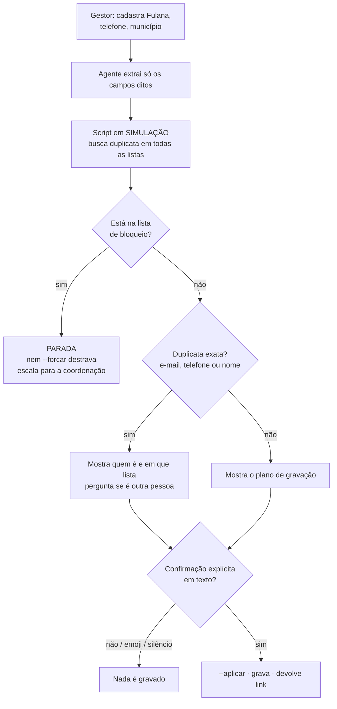

# 05 · Humano no circuito

Dois fluxos cobrem quase tudo que um agente faz numa operação: **produzir texto** que alguém vai
mandar, e **gravar dado** num sistema. Os dois terminam num humano, por desenho.

## Fluxo 1: rascunho → aprovação → envio

### Travas implementadas

Código em [`ops/bot_rascunho/`](../ops/bot_rascunho/). Todas rodam no `demo.py`, sem rede.

| Trava | Onde | Por quê |
|---|---|---|
| Base filtrada por camada | `carregar_base` | O modelo não pode vazar o que não recebeu |
| Dado pessoal mascarado antes do modelo | `mascarar_dados_pessoais` | Minimização (LGPD): o modelo não precisa do telefone para redigir |
| Pré-filtro de escalação determinístico | `RegrasEscalacao` + `escalacao.json` | O modelo também escala pela persona; o código garante o mínimo se ele falhar |
| Checagem de saída | `checar_saida` | Rascunho que se apresenta como a pessoa ou promete vaga fica BLOQUEADO e não pode ser aprovado |
| Lista de aprovadores | `FilaDeAprovacao.decidir` | Só quem tem alçada aprova |
| Proibição de autoaprovação | idem | Quem pediu não aprova o próprio pedido |
| Trilha de auditoria append-only | `_registrar` | Cada criação, tentativa negada, aprovação e rejeição vira uma linha JSON com autor e hora |
| Envio humano | `bot_discord.py` | O bot não tem caminho para falar com o público |

### Por que o envio é do código, e não do modelo

Num sistema anterior, o agente era responsável por chamar a ferramenta de envio do chat. Em
produção, uma pessoa fez **a mesma pergunta 8 vezes** ao longo de horas: o agente redigiu a
resposta todas as vezes e não enviou nenhuma, porque escreveu no próprio registro em vez de
chamar a ferramenta. Do lado de fora, parecia um bot mudo.

Duas correções, em camadas:
1. Na persona: "**sua resposta só existe se você enviar**", e "escalar não substitui responder"
   (a marcação de escalação é para a equipe; a pessoa ainda precisa receber uma frase).
2. No desenho: no bot de rascunho deste repositório, o modelo só produz texto; publicar no canal
   de revisão é uma linha de código determinística. O que não depende do modelo não tem como ser
   esquecido pelo modelo.

## Fluxo 2: gravação em CRM com simulação e confirmação

Código em [`integracoes/clickup/operar_contato.py`](../integracoes/clickup/operar_contato.py) e
persona em [`agentes/operador-crm.md`](../agentes/operador-crm.md).

| Regra | Implementação |
|---|---|
| Simulação por padrão | Sem `--aplicar`, nada é gravado |
| Duplicata por igualdade exata após normalização | Sem "parecido": se apontou, é sinal forte e o agente não relativiza |
| Duplicata comum exige decisão humana | `--forcar` só quando o gestor diz que é outra pessoa |
| Lista de bloqueio é parada, não duplicata | Quem pediu para não ser contatado só volta por decisão da coordenação (obrigação de LGPD) |
| Um contato por vez | Lote = um a um, cada um com simulação e confirmação |
| Confirmação explícita em texto | Emoji, silêncio ou mensagem ambígua não contam |
| Sem rota alternativa | Erro do script: mostra e para. O agente não tem shell para "investigar" |
| Não apaga, não mescla, não exporta | Fora do escopo; escala para a coordenação |

## Permissões: a terceira situação

Em agentes com ferramentas, há três situações, não duas:

| Ferramenta | O que acontece |
|---|---|
| Na lista `allow` | Roda direto |
| Na lista `deny` | Vira erro só para quem estava falando com o agente |
| **Em nenhuma das duas** | Vira **pedido de autorização** |

Num agente ligado a um canal de chat com várias pessoas pareadas, o pedido de autorização é
enviado **para a conversa de todas elas**, e qualquer uma pode aprovar, sem contexto e vendo o
comando inteiro que o agente quer rodar. Para um agente que opera dados de contatos, isso é ao
mesmo tempo um risco de aprovação indevida e de exposição de dado pessoal.

Regra resultante: **agente em produção nunca pede permissão.** Tudo que ele usa está em `allow`;
tudo que ele poderia tentar está em `deny` explicitamente (ver
[`ops/permissoes/settings.producao.exemplo.json`](../ops/permissoes/settings.producao.exemplo.json)).
Cuidado com prefixos: negar `python` bloquearia `python3`, o único comando permitido.

## Para empresas

| Processo | Rascunho → aprovação → envio | Simulação → confirmação → gravação |
|---|---|---|
| SAC | Resposta a reclamação sugerida; supervisor aprova casos com valor acima da alçada | Abertura de ticket e atualização de cadastro |
| Cobrança | Proposta de acordo dentro da política; fora dela, escala | Registro do acordo no ERP |
| RH | Resposta a dúvida de benefício | Alteração cadastral só com conferência |
| Compliance | Parecer preliminar com citação da norma | Registro de ocorrência, sem exclusão |
